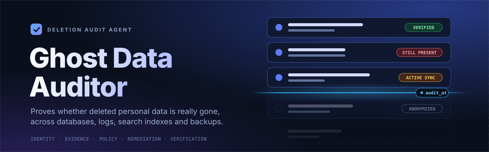

<p align="center">
  
</p>

<p align="center">
  
  
  
  
</p>

# Ghost Data Auditor

An audit agent for the HackerRank Orchestrate challenge **"Ghost Data Still Exists"** (fictional company *Northstar Shop*).
A deletion ticket saying **"Complete"** is only a claim. This tool investigates the supplied records and decides whether the
person's data is **really** gone, and if not, produces the ordered steps needed to fix it.

For every deletion request it outputs:

| Output | Meaning |
|---|---|
| `deletion_status` | `COMPLETE`, `INCOMPLETE`, or `NOT_APPLICABLE` (the person never asked for deletion) |
| `steps_json` | Ordered array of **findings → remediation → verification** steps |

## How it works

```
request ──► classify ──► resolve identity ──► scan evidence ──► state at audit_at ──► apply policy ──► plan steps
            (delete?)    emails, phones,      SQL · JSON ·      snapshots + SUCCESS    deletion_rules   FINDING
                         names, hashes,       logs · txt ·      activity after the     .csv             REMEDIATION
                         user_ids (history)   PDF · images      snapshot                                VERIFICATION
```

1. **Classify** the request text (multilingual keywords, negation aware: *"do not close the account"* ⇒ `NOT_APPLICABLE`).
2. **Resolve identity** from `user_identities.csv` and `user_audit_log.csv`: current and historical emails, phones, names,
   `user_id`, and computed email hashes.
3. **Scan evidence** once into observations (resource, system, time, state): SQL snapshots (`record_json`, primary vs replica),
   JSON bundles, key=value logs (linked by `trace_id`), handover text, PDFs and images.
4. **Reconstruct state at `audit_at`**: latest snapshot at or before `audit_at`, then later `SUCCESS` activity
   (deletes, redactions, re-syncs, restores). `FAILED` and `PARTIAL` results are treated as unreliable claims.
5. **Apply policy** from `deletion_rules.csv` per data category: delete, redact, anonymize, retain, disable data flows, block restores.
6. **Plan** deterministic, correctly ordered steps (phase → operation → `system_id` → `resource_id`).

> **Design principle:** all decisions are made by deterministic code. The LLM/VLM (Groq) is optional and used only to read
> images and scanned documents, and for ambiguous request wording. Responses are cached and token usage is logged.

## Quick start

```bash
git clone <your-repo-url> && cd ghost-data-auditor
python -m venv .venv && source .venv/bin/activate      # Windows: .venv\Scripts\activate
pip install -r requirements.txt
```

Put the challenge `dataset/` folder next to `app.py`, then:

```bash
streamlit run app.py                                         # web UI
python run_cli.py --data dataset --out output.csv --sample   # CLI + evaluation + usage report
python explain_case.py dataset case_05                       # debug one case (actual vs expected)
python -m tests.test_synthetic                               # team-created test cases
```

Optional Groq vision/LLM:

```bash
cp .env.example .env            # add GROQ_API_KEY, never commit it
export GROQ_API_KEY=gsk_...     # Windows PowerShell: $env:GROQ_API_KEY="gsk_..."
python run_cli.py --data dataset --out output.csv --groq
```

## Project structure

```
app.py                  Streamlit UI (run, case explorer, evaluation, usage, submission)
run_cli.py              Batch runner: output.csv + evaluation + usage reports
explain_case.py         Per-case debugger (linked resources, inferred states, expected vs actual)
inspect_data.py         Prints dataset schemas/samples to adapt parsers
audit/
  classify.py           Deletion vs non-deletion requests
  identity.py           Identity closure + hashes + identifier matcher
  evidence.py           SQL / JSON / log / text / PDF / image parsers
  activity.py           system_activity.csv effects and links
  rules.py              deletion_rules.csv + category inference
  pipeline.py           Auditor: state resolution + policy decisions
  planner.py            Step ordering and verification mapping
  evaluate.py           Status, step, field and sequence metrics
  usage.py              Token and cost report
  llm.py                Cached Groq client (token counted)
tests/test_synthetic.py Additional evaluation cases
evaluation/             evaluation_report.md, usage_report.md
```

## Output format

```csv
case_id,deletion_status,steps_json
case_01,COMPLETE,"[{""step_no"":1,""phase"":""VERIFICATION"",""system_id"":""account_service"",""resource_id"":""account_001"",""operation"":""VERIFY_RECORD_ABSENT"",""state"":""ABSENT"",""evidence_id"":""evidence_54""}]"
case_533,NOT_APPLICABLE,[]
```

Rules enforced: findings first, then remediation, then verification; consecutive `step_no`; `COMPLETE` cites evidence on every step;
proposed remediation/verification steps for `INCOMPLETE` have an empty `evidence_id`; `NOT_APPLICABLE` is always `[]`.

## Evaluation

`python run_cli.py --data dataset --sample` scores the agent against `sample_output.csv` and writes
`evaluation/evaluation_report.md`: case-level status accuracy, step-level precision/recall/F1, field-level accuracy,
sequence accuracy (LCS), team-created cases and a list of failures. Token and cost totals go to `evaluation/usage_report.md`.

## Known limitations

- Several policy conditions are heuristics (shared support context, retention period, legal-hold activity) until confirmed on the full data.
- Image and PDF evidence needs Groq vision or `pdftotext`/`pypdf` to be read.
- Parsers were written against the challenge's file formats; different layouts may need small changes in `audit/evidence.py`.

## Privacy and security

All data in the challenge is fictional. API keys are read from the environment or the sidebar, are never written to disk or to output files,
and `.env`, `.cache/` and `dataset/` are git-ignored.

---
<sub>Built for HackerRank Orchestrate (Oct 2026). Fictional company and data.</sub>
